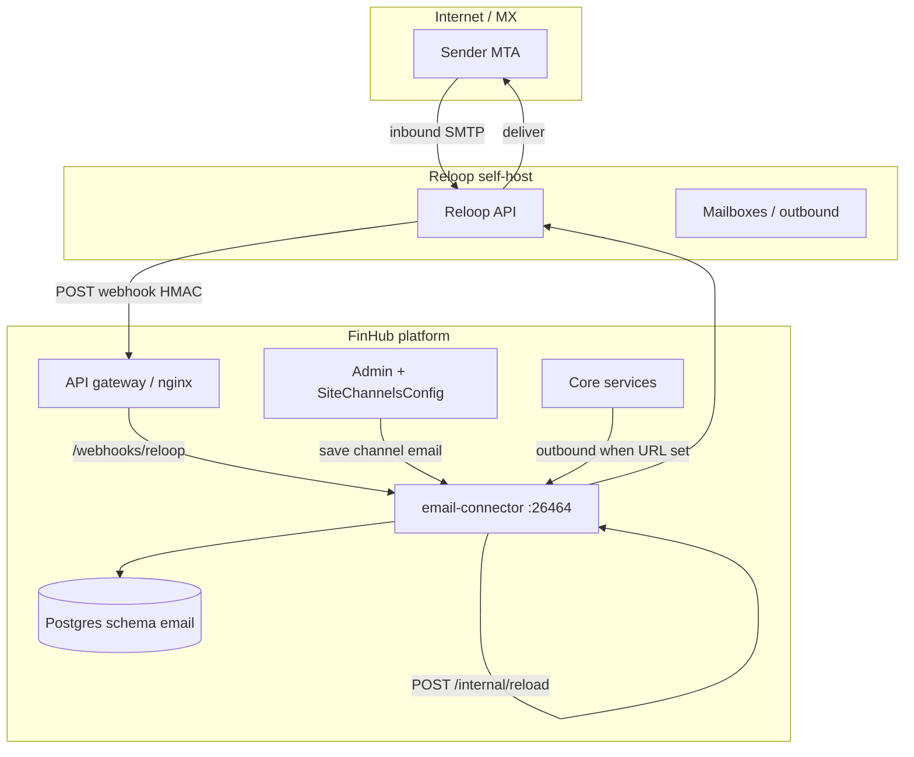

[English](./email-channel.md) | [简体中文](./email-channel.zh-CN.md) | [繁體中文](./email-channel.zh-TW.md)

# Email channel (optional, Reloop)

FinHub can deliver **agent email** over a platform-managed transport: one **verified sending domain** shared by the deployment, with a **Reloop mailbox** provisioned per `(tenant, user, agent)` tuple. **Bind model A** applies: at most **one sender address bound per tenant** at a time.

The **email-connector** service is **optional** and **off by default**. Stopping it does **not** stop web chat. Outbound email from other platform paths fans out to the connector only when `EMAIL_CONNECTOR_URL` / `CONFIG_EMAIL_CONNECTOR_URL` is set.

**Production:** run **Reloop self-hosted** on your network. **Reloop Cloud** is for **demo/lab only** (tenant leaves `api_base_url` empty in Admin). This guide does not cover v1 **BYO Gmail/IMAP**, **agentmail.to**, or **per-tenant custom domains**.

Exact compose service names, image tags, and Helm keys ship in your **offline release**; reconcile any `<!-- TODO(packaging): ... -->` markers when your bundle version includes email packaging.

## Architecture



| Component | Default in bundle? | Role |
|-----------|-------------------|------|
| **email-connector** | No (`email` profile / `emailConnector.enabled: false`) | Webhooks, bind/provision APIs, outbound send |
| **Reloop** | Operator-supplied (self-host) | MX, API, mailbox lifecycle |
| **Admin channel `email`** | UI in Admin → Channels → Email | Tenant `reloop_*` settings; secrets masked on GET/PUT |
| **End-user bind UI** | Not shipped in v1 | Use HTTP APIs with user Bearer token |

### Data model (schema `email`)

| Table | Purpose |
|-------|---------|
| `email_agent_mailbox_bind` | Active mailbox binding per user/agent |
| `email_bind_state_used` | One-time bind state consumption |
| `email_user_agent_preference` | Preferred agent for inbound mail |
| `email_processed_message` | Idempotency / inbound processing audit |

## Prerequisites

| Requirement | Notes |
|-------------|--------|
| FinHub core stack healthy | [`install.md`](./install.md) → `doctor.sh` clean |
| Postgres reachable by connector | Release wires convstore / platform DB URL |
| **Reloop self-host** | Production MTA + API; not Reloop Cloud |
| Verified **platform domain** | DNS per Reloop docs; obtain `domain_id` from Reloop admin/API |
| Public **HTTPS** gateway | Webhook URL `https://<gateway-host>/webhooks/reloop` with valid TLS |
| `INTERNAL_SERVICE_TOKEN` | Shared fleet secret ([`env-reference.md`](./env-reference.md)); used on `/internal/*` |

## Reloop self-host and API key

1. Deploy Reloop using the vendor’s self-host guide (version pinned in your SecOps runbook).
2. Create an API key with prefix `rl_…` for FinHub (store in vault; configure in Admin only).
3. Register the **same verified domain** you will set as `agent_mailbox_domain` in Admin.
4. Complete Reloop **domain verification**; record **`domain_id`** for Admin channel config.
5. Configure Reloop to POST inbound events to:

   `https://<gateway-host>/webhooks/reloop`

   Use the **webhook signing secret** Reloop provides; copy it into Admin as `webhook_secret` (never commit).

For lab demos only, tenants may omit `api_base_url` to target Reloop Cloud — **do not use in production**.

## DNS (MX, SPF, DKIM, verification)

Follow **Reloop’s current documentation** for your domain. Typical operator checklist:

| Record type | Purpose |
|-------------|---------|
| **MX** | Point to Reloop inbound hosts Reloop specifies for your install |
| **SPF** | Include Reloop outbound sources for the verified domain |
| **DKIM** | Publish selectors Reloop gives after domain setup |
| **Domain verification** | TXT or CNAME token until Reloop reports verified |

After DNS propagates, confirm in Reloop UI/API that the domain is **verified** and note **`domain_id`** for Admin.

## Network and ingress

| Path | Exposure | Auth |
|------|----------|------|
| `POST /webhooks/reloop` | **Public** via gateway | HMAC signature (Reloop `webhook_secret`) |
| `GET /internal/health` | Internal / mesh | None or release-specific |
| `/internal/status`, `/reload`, `/test-connection`, `/send-outbound`, `/provision`, `/bind` | Internal only | `INTERNAL_SERVICE_TOKEN` |
| `/api/email/*` | Via gateway as documented | User **Bearer** JWT |

Gateway must route `/webhooks/reloop` to **email-connector** listener **26464** without stripping headers required for HMAC verification.

<!-- TODO(packaging): confirm nginx location block and upstream service name in release `docker-compose.prod.yml` / Helm ingress templates. -->

**TLS:** terminate HTTPS at your ingress; Reloop webhooks must reach the public URL with a certificate chain clients trust.

## Enable the connector

### Docker Compose

Default posture: **disabled**. When your release ships the `email` profile:

<!-- TODO(packaging): confirm email-connector image repository/tag in CHATKIT_REGISTRY and `load-images.sh` manifest. -->

<!-- TODO(packaging): confirm exact compose invocation from release README, e.g. `docker compose -f docker-compose.prod.yml --profile email up -d email-connector`. -->

<!-- TODO(packaging): insert documented `-f` overlay file name if the release ships one beside docker-compose.prod.yml. -->

```bash
# Example — verify against your release README before production
docker compose -f docker-compose.prod.yml \
  --profile email \
  up -d email-connector
```

<!-- TODO(packaging): confirm compose service name (placeholder above: `email-connector`) and profile name (`email`). -->

Set platform env so core services can reach the connector (see table below). Restart affected services after enabling outbound.

### Helm

<!-- TODO(packaging): confirm chart value path, e.g. `emailConnector.enabled: true` and secret/env key names in values schema. -->

```bash
helm upgrade --install <release> <chart-path> \
  -f deploy/helm/values-whitelabel.yaml \
  --set emailConnector.enabled=true
```

Ensure ingress exposes `/webhooks/reloop` to the connector Service port **26464**.

## Environment and secrets

| Variable | Secret | Who sets | Notes |
|----------|--------|----------|-------|
| `INTERNAL_SERVICE_TOKEN` | Yes | `gen-secrets.sh` / operator | Required for `/internal/*`; rotate with release procedure |
| `EMAIL_CONNECTOR_URL` | No | Operator | Base URL for core → connector outbound fan-out (e.g. `http://email-connector:26464`) |
| `CONFIG_EMAIL_CONNECTOR_URL` | No | Operator | Alternate/config service hook when release documents it |
| `DATABASE_URL` / convstore DSN | Yes | Release / operator | Connector needs schema `email`; exact key in release `.env.example` |
| `reloop_api_key` | Yes | **Admin** → Channels → Email | Masked on GET/PUT; prefix `rl_…` |
| `webhook_secret` | Yes | **Admin** | HMAC for `/webhooks/reloop`; masked in Admin API |
| `domain_id` | No | **Admin** | From Reloop after verification |
| `agent_mailbox_domain` | No | **Admin** | Platform shared verified domain |
| `api_base_url` | No | **Admin** (optional) | Set for self-host Reloop API; **empty** → Reloop Cloud (demo only) |

Tenant channel fields persist in **SiteChannelsConfig** (`channel` id `email`). Saving in Admin triggers `POST /internal/reload` on the connector.

## Admin console setup (steps A–E)

| Step | Action |
|------|--------|
| **A. Enable runtime** | Bring up `email-connector` (compose profile or Helm) and set `EMAIL_CONNECTOR_URL` / `CONFIG_EMAIL_CONNECTOR_URL` if outbound email is required. |
| **B. Reloop** | Self-host Reloop; create `rl_…` API key; configure webhook URL and signing secret. |
| **C. DNS** | Publish MX/SPF/DKIM/verification; wait for Reloop domain verified; copy `domain_id`. |
| **D. Admin → Channels → Email** | Enter `reloop_api_key`, `webhook_secret`, `domain_id`, `agent_mailbox_domain`, and `api_base_url` (self-host API root). Save (reloads connector). |
| **E. Verify** | Run internal status and test-connection (below); complete bind/provision smoke via API. |

Secrets appear **masked** in Admin GET/PUT responses — re-paste full values only when rotating.

## Verification

### Status fields

Query connector internal status (service token):

```bash
curl -sS -H "Authorization: Bearer <INTERNAL_SERVICE_TOKEN>" \
  http://email-connector:26464/internal/status
```

Interpret typical flags:

| Field | Meaning |
|-------|---------|
| `transport_ready` | Reloop API reachable with tenant/admin config |
| `domain_verified` | Configured domain passes Reloop verification |
| `webhook_configured` | Webhook secret and public URL coherent |
| `last_inbound_at` | Recent inbound webhook processed (null until first mail) |

### Test connection

```bash
curl -sS -X POST -H "Authorization: Bearer <INTERNAL_SERVICE_TOKEN>" \
  http://email-connector:26464/internal/test-connection
```

### End-to-end (API only — no shipped bind UI)

Replace placeholders; use a real user JWT from your IdP/login flow.

**1. Provision mailbox**

```bash
curl -sS -X POST \
  -H "Authorization: Bearer <USER_ACCESS_TOKEN>" \
  -H "Content-Type: application/json" \
  -d '{"agent_id":"<AGENT_UUID>"}' \
  https://<gateway-host>/api/email/provision
```

**2. Bind sender (one per tenant)**

```bash
curl -sS -X POST \
  -H "Authorization: Bearer <USER_ACCESS_TOKEN>" \
  -H "Content-Type: application/json" \
  -d '{"agent_id":"<AGENT_UUID>","bind_state":"<BIND_STATE_FROM_PROVISION>"}' \
  https://<gateway-host>/api/email/bind
```

**3. Check bind state**

```bash
curl -sS -H "Authorization: Bearer <USER_ACCESS_TOKEN>" \
  "https://<gateway-host>/api/email/bind/state?agent_id=<AGENT_UUID>"
```

**4. User status**

```bash
curl -sS -H "Authorization: Bearer <USER_ACCESS_TOKEN>" \
  https://<gateway-host>/api/email/status
```

**5. Inbound mail** — send email from an external mailbox to the provisioned address; confirm `last_inbound_at` updates and the agent receives the thread per your product routing.

**6. Outbound reply** — trigger agent reply on the email thread (product-specific); confirm delivery only when `EMAIL_CONNECTOR_URL` is set.

## Monitoring and logs

| Signal | Source |
|--------|--------|
| Liveness | `GET /internal/health` on port **26464** |
| Webhook failures | Gateway + connector logs (4xx on bad HMAC) |
| Reloop errors | Connector logs around `/internal/test-connection` and send-outbound |
| DB | Migrations for schema `email`; watch connection errors |

Optional Prometheus: scrape only if the release exposes `/metrics` on the connector (not assumed in v1). Prefer log alerts on repeated webhook 401/403 and outbound 5xx.

## Disable and rollback

1. Remove or comment `EMAIL_CONNECTOR_URL` / `CONFIG_EMAIL_CONNECTOR_URL` to stop outbound fan-out.
2. Scale down compose profile or `emailConnector.enabled=false` on Helm.
3. Disable channel in Admin or clear tenant secrets per your change window.
4. Reloop: disable webhook or rotate secret if retiring the channel.

Core chat remains available throughout.

## Troubleshooting

| Symptom | Checks |
|---------|--------|
| `domain_verified: false` | DNS propagation; `domain_id` matches Reloop; `agent_mailbox_domain` spelling |
| Webhook 401/403 | `webhook_secret` in Admin matches Reloop; gateway preserves body for HMAC |
| No inbound | MX points to Reloop; Reloop webhook URL is public HTTPS; firewall allows Reloop → gateway |
| Outbound never sends | `EMAIL_CONNECTOR_URL` unset in core; connector up; `transport_ready` true |
| Bind fails | One bind per tenant; consume fresh `bind_state`; user token valid |
| Demo cloud in prod | Non-empty self-host `api_base_url` in Admin; block empty `api_base_url` in policy |

## Known limits (v1)

- **Bind model A** only — platform-shared domain; not per-tenant custom domains.
- **One** active sender bind per tenant.
- **No** end-user bind UI — API + Admin only.
- **No** BYO Gmail/IMAP or agentmail.to.
- Outbound from non-email features requires explicit connector URL wiring.

## Security notes

| Topic | Guidance |
|-------|----------|
| **Secret rotation** | Rotate `reloop_api_key` and `webhook_secret` in Reloop + Admin together; save to reload connector. Rotate `INTERNAL_SERVICE_TOKEN` per fleet procedure and restart connector. |
| **HMAC webhooks** | Treat `webhook_secret` as credential; reject unsigned or wrong-signature posts at connector. |
| **Admin API** | Masked secrets still authorize channel operation — restrict Admin access. |
| **TLS** | Do not expose connector :26464 directly on the internet; only gateway routes. |

## Related

- [Install](./install.md) · [Environment reference](./env-reference.md) · [Smoke checklist](../smoke-checklist.md)
- [Agent deploy runbook](../agent-deploy-runbook.md) · [`skills/finhub-deploy/SKILL.md`](../../skills/finhub-deploy/SKILL.md)
