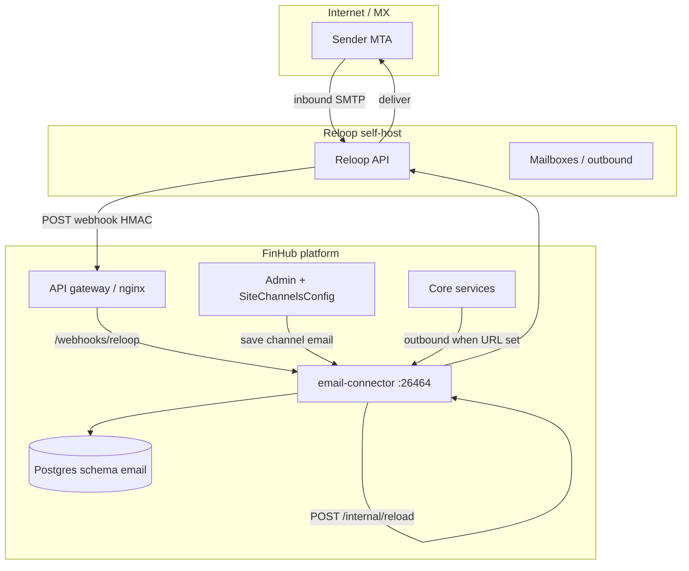

[English](./email-channel.md) | [简体中文](./email-channel.zh-CN.md) | [繁體中文](./email-channel.zh-TW.md)

# 邮件渠道（可选，Reloop）

FinHub 可通过平台托管传输投递 **智能体邮件**：全站共用 **一个已验证发信域**，按 `(tenant, user, agent)` 三元组在 Reloop 上 **开通邮箱**。**绑定模型 A**：每个租户同时最多 **绑定一个发件地址**。

**email-connector** 服务为 **可选**，**默认关闭**。停止该服务 **不会** 影响网页对话。仅当配置了 `EMAIL_CONNECTOR_URL` / `CONFIG_EMAIL_CONNECTOR_URL` 时，其它平台路径才会把外发邮件转发到 connector。

**生产环境：** 在自有网络 **自建 Reloop**。**Reloop Cloud** 仅用于 **演示/实验**（Admin 中 `api_base_url` 留空）。本文不包含 v1 的 **自带 Gmail/IMAP**、**agentmail.to** 或 **每租户独立域名**。

Compose 服务名、镜像 tag、Helm 键以 **离线发布包** 为准；发布包包含邮件打包后，请对照并消除文中的 `<!-- TODO(packaging): ... -->` 标记。

## 架构



| 组件 | 默认随包启用？ | 作用 |
|------|----------------|------|
| **email-connector** | 否（`email` profile / `emailConnector.enabled: false`） | Webhook、绑定/开通 API、外发 |
| **Reloop** | 运维自建 | MX、API、邮箱生命周期 |
| **Admin 渠道 `email`** | Admin → 渠道 → 邮件 | 租户 `reloop_*` 配置；GET/PUT 脱敏 |
| **终端用户绑定 UI** | v1 未交付 | 使用用户 Bearer 调 HTTP API |

### 数据模型（schema `email`）

| 表 | 用途 |
|----|------|
| `email_agent_mailbox_bind` | 用户/智能体邮箱绑定 |
| `email_bind_state_used` | 一次性绑定状态消费 |
| `email_user_agent_preference` | 入站邮件首选智能体 |
| `email_processed_message` | 幂等 / 入站处理审计 |

## 前置条件

| 要求 | 说明 |
|------|------|
| FinHub 核心栈健康 | [`install.zh-CN.md`](./install.zh-CN.md) → `doctor.sh` 通过 |
| Postgres 可被 connector 访问 | 发布包配置 convstore / 平台 DSN |
| **Reloop 自建** | 生产 MTA + API；非 Reloop Cloud |
| 已验证 **平台域名** | 按 Reloop 文档配 DNS；从 Reloop 获取 `domain_id` |
| 公网 **HTTPS** 网关 | Webhook `https://<gateway-host>/webhooks/reloop`，有效 TLS |
| `INTERNAL_SERVICE_TOKEN` | 机群共享密钥（[`env-reference.zh-CN.md`](./env-reference.zh-CN.md)）；用于 `/internal/*` |

## Reloop 自建与 API 密钥

1. 按厂商自建文档部署 Reloop（版本由 SecOps 固定）。
2. 为 FinHub 创建前缀 `rl_…` 的 API 密钥（存保险箱；仅在 Admin 配置）。
3. 注册与 Admin 中 `agent_mailbox_domain` **相同** 的已验证域名。
4. 完成 Reloop **域名验证**；记录 **`domain_id`** 供 Admin 渠道配置。
5. 配置 Reloop 将入站事件 POST 到：

   `https://<gateway-host>/webhooks/reloop`

   使用 Reloop 提供的 **Webhook 签名密钥**；写入 Admin 的 `webhook_secret`（勿提交到 git）。

仅实验环境可省略 `api_base_url` 以使用 Reloop Cloud — **生产禁止使用**。

## DNS（MX、SPF、DKIM、验证）

遵循 **Reloop 当前文档**。运维常见项：

| 记录类型 | 用途 |
|----------|------|
| **MX** | 指向 Reloop 为本安装指定的入站主机 |
| **SPF** | 为已验证域名包含 Reloop 出站源 |
| **DKIM** | 发布 Reloop 在域名配置后提供的 selector |
| **域名验证** | TXT 或 CNAME，直至 Reloop 显示已验证 |

DNS 生效后，在 Reloop UI/API 确认域名 **已验证**，记下 **`domain_id`**。

## 网络与入口

| 路径 | 暴露范围 | 鉴权 |
|------|----------|------|
| `POST /webhooks/reloop` | 经网关 **公网** | HMAC（Reloop `webhook_secret`） |
| `GET /internal/health` | 内网 / mesh | 无或随发布包 |
| `/internal/status`、`/reload`、`/test-connection`、`/send-outbound`、`/provision`、`/bind` | 仅内网 | `INTERNAL_SERVICE_TOKEN` |
| `/api/email/*` | 经网关 | 用户 **Bearer** JWT |

网关须将 `/webhooks/reloop` 转到 **email-connector** **26464**，且勿剥离 HMAC 所需头/正文。

<!-- TODO(packaging): confirm nginx location block and upstream service name in release `docker-compose.prod.yml` / Helm ingress templates. -->

**TLS：** 在入口终结 HTTPS；Reloop Webhook 须能访问受信任的公网 URL。

## 启用 connector

### Docker Compose

默认 **关闭**。发布包提供 `email` profile 时：

<!-- TODO(packaging): confirm email-connector image repository/tag in CHATKIT_REGISTRY and `load-images.sh` manifest. -->

<!-- TODO(packaging): confirm exact compose invocation from release README, e.g. `docker compose -f docker-compose.prod.yml --profile email up -d email-connector`. -->

<!-- TODO(packaging): insert documented `-f` overlay file name if the release ships one beside docker-compose.prod.yml. -->

```bash
# 示例 — 生产前以发布包 README 为准
docker compose -f docker-compose.prod.yml \
  --profile email \
  up -d email-connector
```

<!-- TODO(packaging): confirm compose service name (placeholder above: `email-connector`) and profile name (`email`). -->

配置平台环境变量使核心服务可访问 connector（见下表）。启用外发后重启相关服务。

### Helm

<!-- TODO(packaging): confirm chart value path, e.g. `emailConnector.enabled: true` and secret/env key names in values schema. -->

```bash
helm upgrade --install <release> <chart-path> \
  -f deploy/helm/values-whitelabel.yaml \
  --set emailConnector.enabled=true
```

确认 Ingress 将 `/webhooks/reloop` 暴露到 connector Service 端口 **26464**。

## 环境与密钥

| 变量 | 密钥？ | 谁配置 | 说明 |
|------|--------|--------|------|
| `INTERNAL_SERVICE_TOKEN` | 是 | `gen-secrets.sh` / 运维 | `/internal/*` 必需；按发布包流程轮换 |
| `EMAIL_CONNECTOR_URL` | 否 | 运维 | 核心 → connector 外发基址（如 `http://email-connector:26464`） |
| `CONFIG_EMAIL_CONNECTOR_URL` | 否 | 运维 | 发布包文档中的配置服务备用 URL |
| `DATABASE_URL` / convstore DSN | 是 | 发布包 / 运维 | connector 需要 schema `email`；键名见 `.env.example` |
| `reloop_api_key` | 是 | **Admin** → 渠道 → 邮件 | GET/PUT 脱敏；前缀 `rl_…` |
| `webhook_secret` | 是 | **Admin** | `/webhooks/reloop` HMAC；Admin API 脱敏 |
| `domain_id` | 否 | **Admin** | Reloop 验证后取得 |
| `agent_mailbox_domain` | 否 | **Admin** | 平台共享已验证域名 |
| `api_base_url` | 否 | **Admin**（可选） | 自建 Reloop API 根 URL；**留空** → Reloop Cloud（仅演示） |

租户渠道字段存于 **SiteChannelsConfig**（`channel` id `email`）。Admin 保存会触发 connector 上 `POST /internal/reload`。

## Admin 控制台（步骤 A–E）

| 步骤 | 操作 |
|------|------|
| **A. 启用运行时** | 拉起 `email-connector`（compose profile 或 Helm）；若需外发邮件则设置 `EMAIL_CONNECTOR_URL` / `CONFIG_EMAIL_CONNECTOR_URL`。 |
| **B. Reloop** | 自建 Reloop；创建 `rl_…` API 密钥；配置 Webhook URL 与签名密钥。 |
| **C. DNS** | 发布 MX/SPF/DKIM/验证记录；等待 Reloop 域名验证；复制 `domain_id`。 |
| **D. Admin → 渠道 → 邮件** | 填写 `reloop_api_key`、`webhook_secret`、`domain_id`、`agent_mailbox_domain`、`api_base_url`（自建 API 根）。保存（触发 reload）。 |
| **E. 验证** | 执行下文状态与 test-connection；通过 API 完成开通/绑定冒烟。 |

Admin GET/PUT 中密钥 **脱敏** — 仅在轮换时重新粘贴完整值。

## 验证

### 状态字段

使用服务令牌查询内部状态：

```bash
curl -sS -H "Authorization: Bearer <INTERNAL_SERVICE_TOKEN>" \
  http://email-connector:26464/internal/status
```

常见字段：

| 字段 | 含义 |
|------|------|
| `transport_ready` | 按租户/Admin 配置可访问 Reloop API |
| `domain_verified` | 配置域名通过 Reloop 验证 |
| `webhook_configured` | Webhook 密钥与公网 URL 一致 |
| `last_inbound_at` | 最近处理入站 Webhook（首封邮件前可为 null） |

### 测试连接

```bash
curl -sS -X POST -H "Authorization: Bearer <INTERNAL_SERVICE_TOKEN>" \
  http://email-connector:26464/internal/test-connection
```

### 端到端（仅 API — 无绑定 UI）

替换占位符；使用登录流程得到的真实用户 JWT。

**1. 开通邮箱**

```bash
curl -sS -X POST \
  -H "Authorization: Bearer <USER_ACCESS_TOKEN>" \
  -H "Content-Type: application/json" \
  -d '{"agent_id":"<AGENT_UUID>"}' \
  https://<gateway-host>/api/email/provision
```

**2. 绑定发件人（每租户一个）**

```bash
curl -sS -X POST \
  -H "Authorization: Bearer <USER_ACCESS_TOKEN>" \
  -H "Content-Type: application/json" \
  -d '{"agent_id":"<AGENT_UUID>","bind_state":"<BIND_STATE_FROM_PROVISION>"}' \
  https://<gateway-host>/api/email/bind
```

**3. 查询绑定状态**

```bash
curl -sS -H "Authorization: Bearer <USER_ACCESS_TOKEN>" \
  "https://<gateway-host>/api/email/bind/state?agent_id=<AGENT_UUID>"
```

**4. 用户状态**

```bash
curl -sS -H "Authorization: Bearer <USER_ACCESS_TOKEN>" \
  https://<gateway-host>/api/email/status
```

**5. 入站邮件** — 从外部邮箱发到已开通地址；确认 `last_inbound_at` 更新且智能体按产品路由收到会话。

**6. 出站回复** — 在邮件会话上触发智能体回复（因产品而异）；仅在设置 `EMAIL_CONNECTOR_URL` 时确认投递成功。

## 监控与日志

| 信号 | 来源 |
|------|------|
| 存活 | 端口 **26464** 上 `GET /internal/health` |
| Webhook 失败 | 网关 + connector 日志（HMAC 错误 4xx） |
| Reloop 错误 | `/internal/test-connection`、send-outbound 相关日志 |
| 数据库 | schema `email` 迁移；连接错误 |

可选 Prometheus：仅当发布包在 connector 暴露 `/metrics` 时抓取（v1 不默认假设）。建议对重复 Webhook 401/403 与外发 5xx 做日志告警。

## 禁用与回滚

1. 删除或注释 `EMAIL_CONNECTOR_URL` / `CONFIG_EMAIL_CONNECTOR_URL` 以停止外发转发。
2. 关闭 compose profile 或 Helm 设 `emailConnector.enabled=false`。
3. 在 Admin 禁用渠道或按变更窗口清理租户密钥。
4. Reloop：下线 Webhook 或轮换密钥以退役渠道。

核心对话全程可用。

## 故障排查

| 现象 | 检查项 |
|------|--------|
| `domain_verified: false` | DNS 传播；`domain_id` 与 Reloop 一致；`agent_mailbox_domain` 拼写 |
| Webhook 401/403 | Admin `webhook_secret` 与 Reloop 一致；网关保留 HMAC 所需正文 |
| 无入站 | MX 指向 Reloop；Webhook URL 为公网 HTTPS；防火墙允许 Reloop → 网关 |
| 从不外发 | 核心未设 `EMAIL_CONNECTOR_URL`；connector 运行；`transport_ready` 为 true |
| 绑定失败 | 每租户仅一绑；使用新 `bind_state`；用户令牌有效 |
| 生产误用 Cloud | Admin 填写自建 `api_base_url`；策略禁止留空 |

## 已知限制（v1）

- 仅 **绑定模型 A** — 平台共享域名；无每租户自定义域。
- 每租户 **一个** 活跃发件绑定。
- **无** 终端用户绑定 UI — 仅 API + Admin。
- **无** 自带 Gmail/IMAP 或 agentmail.to。
- 非邮件功能外发须显式配置 connector URL。

## 安全说明

| 主题 | 建议 |
|------|------|
| **密钥轮换** | 在 Reloop 与 Admin 同步轮换 `reloop_api_key`、`webhook_secret` 后保存以 reload；按机群流程轮换 `INTERNAL_SERVICE_TOKEN` 并重启 connector。 |
| **HMAC Webhook** | 将 `webhook_secret` 视为凭据；connector 拒绝未签名或签名错误请求。 |
| **Admin API** | 脱敏密钥仍可操作渠道 — 限制 Admin 访问。 |
| **TLS** | 勿将 :26464 直接暴露公网；仅经网关路由。 |

## 相关文档

- [安装](./install.zh-CN.md) · [环境参考](./env-reference.zh-CN.md) · [冒烟清单](../smoke-checklist.zh-CN.md)
- [代理部署手册](../agent-deploy-runbook.zh-CN.md) · [`skills/finhub-deploy/SKILL.md`](../../skills/finhub-deploy/SKILL.md)
