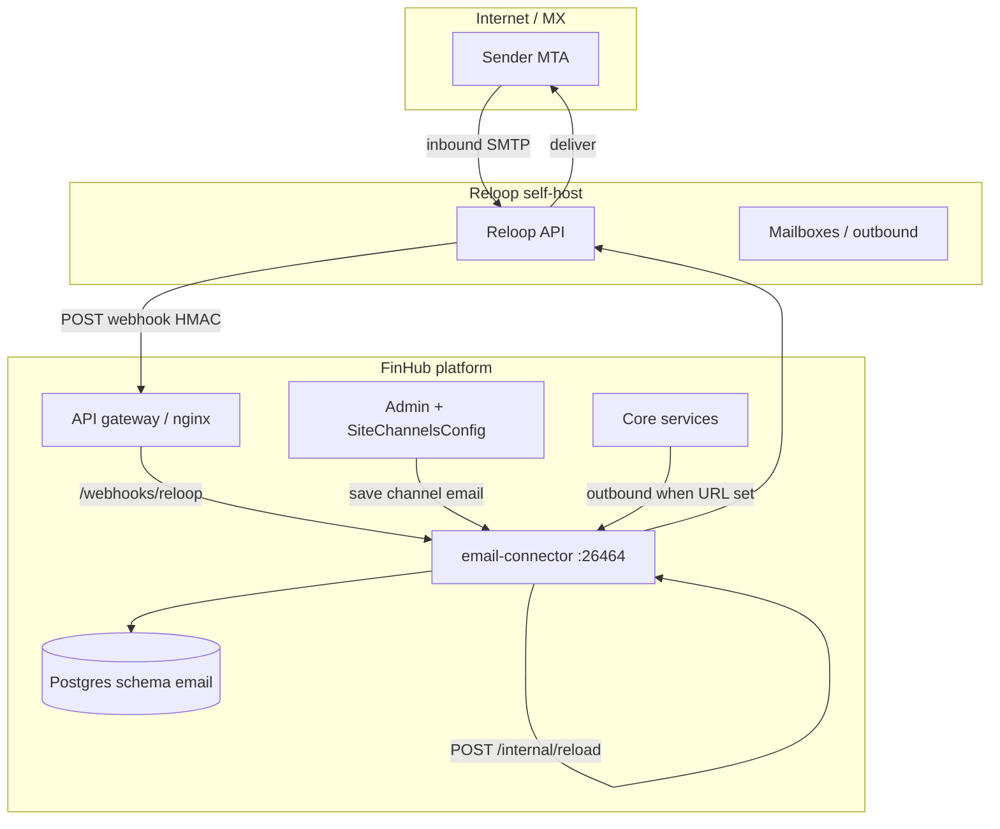

[English](./email-channel.md) | [简体中文](./email-channel.zh-CN.md) | [繁體中文](./email-channel.zh-TW.md)

# 邮件渠道（可选，Reloop）

FinHub 可通过平台托管传输投递 **智能体邮件**：全站共用 **一个已验证发信域**，按 `(tenant, user, agent)` 三元组在 Reloop 上 **开通邮箱**。**绑定模型 A**：每个租户同时最多 **绑定一个发件地址**。

**email-connector** 服务为 **可选**，**默认关闭**。停止该服务 **不会** 影响网页对话。**delivery** 在设置 `EMAIL_CONNECTOR_URL` 与（可选）`CONFIG_EMAIL_CONNECTOR_URL` 后经 connector 外发；**identity-service** 用 `EMAIL_CONNECTOR_URL` 做 Admin test-connection/status。**orchestrator 不使用** `EMAIL_CONNECTOR_URL`。

**生产环境：** 在自有网络 **自建 Reloop**。**Reloop Cloud** 仅用于 **演示/实验**（Admin 中 `api_base_url` 留空）。本文不包含 v1 的 **自带 Gmail/IMAP**、**agentmail.to** 或 **每租户独立域名**。

## 架构



| 组件 | 默认随包启用？ | 作用 |
|------|----------------|------|
| **email-connector** | 否（Compose `email` profile；Helm `services.email-connector.enabled: false`） | Webhook、绑定/开通 API、外发 |
| **Reloop** | 运维自建 | MX、API、邮箱生命周期 |
| **Admin 渠道 `email`** | Admin → 渠道 → 邮件 | 租户 `reloop_*` 配置；GET/PUT 脱敏 |
| **终端用户绑定 UI** | v1 未交付 | 使用用户 Bearer 调 HTTP API |

### 数据模型（schema `email`）

| 表 | 用途 |
|----|------|
| `email_agent_mailbox_bind` | 用户/智能体邮箱绑定 |
| `email_bind_state_used` | 一次性绑定状态消费 |
| `email_user_agent_preference` | 入站邮件首选智能体 |
| `email_processed_message` | 幂等 / 入站处理审计 |

## 前置条件

| 要求 | 说明 |
|------|------|
| FinHub 核心栈健康 | [`install.zh-CN.md`](./install.zh-CN.md) → `doctor.sh` 通过 |
| Postgres `DATABASE_URL` 含 `?schema=email` | **email-connector** 必需（见环境表） |
| **Reloop 自建** | 生产 MTA + API；非 Reloop Cloud |
| 已验证 **平台域名** | 按 Reloop 文档配 DNS；从 Reloop 获取 `domain_id` |
| 公网 **HTTPS** 网关 | Webhook `https://<gateway-host>/webhooks/reloop`，有效 TLS |
| `INTERNAL_SERVICE_TOKEN` | 机群共享密钥（[`env-reference.zh-CN.md`](./env-reference.zh-CN.md)）；用于 `/internal/*` |

## Reloop 自建与 API 密钥

1. 按厂商自建文档部署 Reloop（版本由 SecOps 固定）。
2. 为 FinHub 创建前缀 `rl_…` 的 API 密钥（存保险箱；仅在 Admin 配置）。
3. 注册与 Admin 中 `agent_mailbox_domain` **相同** 的已验证域名。
4. 完成 Reloop **域名验证**；记录 **`domain_id`** 供 Admin 渠道配置。
5. 在 **Reloop 控制台** 中手动注册入站 Webhook URL（FinHub 不会自动注册）：

   `https://<gateway-host>/webhooks/reloop`

   使用 Reloop 提供的 **Webhook 签名密钥**；写入 Admin 的 `webhook_secret`（勿提交到 git）。

仅实验环境可省略 `api_base_url` 以使用 Reloop Cloud — **生产禁止使用**。

## DNS（MX、SPF、DKIM、验证）

遵循 **Reloop 当前文档**。运维常见项：

| 记录类型 | 用途 |
|----------|------|
| **MX** | 指向 Reloop 为本安装指定的入站主机 |
| **SPF** | 为已验证域名包含 Reloop 出站源 |
| **DKIM** | 发布 Reloop 在域名配置后提供的 selector |
| **域名验证** | TXT 或 CNAME，直至 Reloop 显示已验证 |

DNS 生效后，在 Reloop UI/API 确认域名 **已验证**，记下 **`domain_id`**。

## 网络与入口

| 路径 | 暴露范围 | 鉴权 |
|------|----------|------|
| `POST /webhooks/reloop` | 经网关 **公网** | HMAC（Reloop `webhook_secret`） |
| `GET /internal/health` | 内网 / mesh | 无或随发布包 |
| `/internal/status`、`/reload`、`/test-connection`、`/send-outbound`、`/provision`、`/bind` | 仅内网 | `INTERNAL_SERVICE_TOKEN` |
| `/api/email/*` | 经网关 | 用户 **Bearer** JWT |

随包 **API 网关（nginx）** 路由（**勿自行添加 nginx 配置**）：

- `POST /webhooks/reloop`
- `GET /api/email/bind/state`、`POST /api/email/bind`、`POST /api/email/provision`、`GET /api/email/status`

| 部署 | connector 关闭时的网关行为 |
|------|---------------------------|
| **Docker Compose** | 路由保留；variable upstream + resolver 指向 **email-connector:26464** — 网关可启动；connector 未运行前路径返回 **502**。 |
| **Helm** | 仅当 `services.email-connector.enabled: true` 时渲染邮件 nginx 块；关闭时不暴露上述路由（无 502 占位）。 |

保留 Reloop HMAC 校验所需的请求头与正文。

**TLS：** 在入口终结 HTTPS；Reloop Webhook 须能访问受信任的公网 URL。

## 镜像

| 场景 | 镜像引用 |
|------|----------|
| 生产 compose | `${CHATKIT_REGISTRY}/email-connector:${CHATKIT_VERSION}` |
| 离线包（`load-images.sh` 后） | `local/chatkit/email-connector:${VERSION}`（已列入离线镜像清单） |
| GHCR（参考） | `ghcr.io/finogeeks/chatkit/email-connector:<version>` |

Compose：**服务名** `email-connector`，**容器名** `chatkit-email-connector`，**profile** `email`，定义于 **`docker-compose.prod.yml`**（无单独 compose 覆盖文件）。

## 启用 connector

### Docker Compose

默认 **关闭**。在生产 compose 上启用 `email` profile：

```bash
export EMAIL_CONNECTOR_URL=http://chatkit-email-connector:26464
export CONFIG_EMAIL_CONNECTOR_URL=http://chatkit-email-connector:26464
docker compose -f docker-compose.prod.yml --profile email up -d email-connector
# then restart identity-service and delivery so they pick up the URL
```

将 `EMAIL_CONNECTOR_URL` / `CONFIG_EMAIL_CONNECTOR_URL` 写入 `.env`（或发布包文档中的等价机制）后，**重启 identity-service 与 delivery**。

### Helm

Chart 单一开关（发布包 `422800e7` 及以后）：启用 connector 时会自动注入对端 env 与网关路由。

```yaml
services:
  email-connector:
    enabled: true
```

```bash
helm upgrade --install <release> <chart-path> \
  -f deploy/helm/values-whitelabel.yaml \
  --set services.email-connector.enabled=true
```

当 `services.email-connector.enabled: true` 时，chart 为 **identity-service** 与 **delivery** 设置 **`EMAIL_CONNECTOR_URL`**=`http://email-connector:26464`，为 **delivery** 设置 **`CONFIG_EMAIL_CONNECTOR_URL`** 为同一 URL，并渲染邮件 nginx 块。为 **false** 时省略上述 env 且不渲染网关邮件路由 — **勿**在 `servicesEnv` 中手工填写这些 URL。

## 环境与密钥

### email-connector 容器

| 变量 | 密钥？ | 必填 | 说明 |
|------|--------|------|------|
| `DATABASE_URL` | 是 | 是 | Postgres DSN，含 `?schema=email` |
| `PORT` | 否 | 否（默认 **26464**） | 监听端口 |
| `ORCHESTRATOR_URL` | 否 | 是 | orchestrator 基址 |
| `IDENTITY_SERVICE_URL` | 否 | 是 | identity-service 基址 |
| `INTERNAL_SERVICE_TOKEN` | 是 | 是 | 与其它服务相同；`/internal/*` |
| `EMAIL_CONNECTOR_TENANT_ID` | 否 | 否 | 可选单租户过滤 |

**仅 dev/实验后备**（生产用 Admin 渠道字段 — 客户 `.env` 勿设）：

`RELOOP_API_KEY`、`RELOOP_WEBHOOK_SECRET`、`RELOOP_DOMAIN_ID`、`RELOOP_API_BASE_URL`、`EMAIL_CONNECTOR_AGENT_MAILBOX_DOMAIN` 及文档中的 `EMAIL_CONNECTOR_*` 别名。

### 对等服务

| 服务 | 变量 | 密钥？ | 用途 |
|------|------|--------|------|
| **identity-service** | `EMAIL_CONNECTOR_URL` | 否 | Admin test-connection / status |
| **delivery** | `EMAIL_CONNECTOR_URL` | 否 | 外发至 connector |
| **delivery** | `CONFIG_EMAIL_CONNECTOR_URL` | 否 | 可选；发布包接线时的同类钩子 |

**Compose：** 在 `.env` 为 **identity-service** 与 **delivery** 设置 **`http://chatkit-email-connector:26464`**（delivery 可选 `CONFIG_EMAIL_CONNECTOR_URL`），并重启二者。**Helm：** 当 `services.email-connector.enabled: true` 时 chart 自动注入 **`http://email-connector:26464`**（关闭时省略）。**orchestrator 不配置** `EMAIL_CONNECTOR_URL`。

### Admin → 渠道 → 邮件（生产 Reloop）

| 字段 | 密钥？ | 说明 |
|------|--------|------|
| `reloop_api_key` | 是 | GET/PUT 脱敏；前缀 `rl_…` |
| `webhook_secret` | 是 | `/webhooks/reloop` HMAC；Admin API 脱敏 |
| `domain_id` | 否 | Reloop 验证后取得 |
| `agent_mailbox_domain` | 否 | 平台共享已验证域名 |
| `api_base_url` | 否 | 自建 Reloop API 根；**留空** → Reloop Cloud（仅演示） |

租户渠道字段存于 **SiteChannelsConfig**（`channel` id `email`）。Admin 保存会触发 connector 上 `POST /internal/reload`。

## Admin 控制台（步骤 A–E）

| 步骤 | 操作 |
|------|------|
| **A. 启用运行时** | **Compose：** `email` profile + `.env` 对端 URL，重启 identity-service 与 delivery。**Helm：** 仅 `--set services.email-connector.enabled=true`（chart 接线对端与 nginx）。 |
| **B. Reloop** | 自建 Reloop；创建 `rl_…` API 密钥；在 Reloop 控制台 **手动** 注册 Webhook URL 与签名密钥。 |
| **C. DNS** | 发布 MX/SPF/DKIM/验证记录；等待 Reloop 域名验证；复制 `domain_id`。 |
| **D. Admin → 渠道 → 邮件** | 填写 `reloop_api_key`、`webhook_secret`、`domain_id`、`agent_mailbox_domain`、`api_base_url`（自建 API 根）。保存（触发 reload）。 |
| **E. 验证** | 执行下文状态与 test-connection；通过 API 完成开通/绑定冒烟。 |

Admin GET/PUT 中密钥 **脱敏** — 仅在轮换时重新粘贴完整值。

## 验证

### 状态字段

使用服务令牌查询内部状态：

```bash
curl -sS -H "Authorization: Bearer <INTERNAL_SERVICE_TOKEN>" \
  http://chatkit-email-connector:26464/internal/status
```

常见字段：

| 字段 | 含义 |
|------|------|
| `transport_ready` | 按租户/Admin 配置可访问 Reloop API |
| `domain_verified` | 配置域名通过 Reloop 验证 |
| `webhook_configured` | Webhook 密钥与公网 URL 一致 |
| `last_inbound_at` | 最近处理入站 Webhook（首封邮件前可为 null） |

### 测试连接

```bash
curl -sS -X POST -H "Authorization: Bearer <INTERNAL_SERVICE_TOKEN>" \
  http://chatkit-email-connector:26464/internal/test-connection
```

### 端到端（仅 API — 无绑定 UI）

替换占位符；使用登录流程得到的真实用户 JWT。

**1. 开通邮箱**

```bash
curl -sS -X POST \
  -H "Authorization: Bearer <USER_ACCESS_TOKEN>" \
  -H "Content-Type: application/json" \
  -d '{"agent_id":"<AGENT_UUID>"}' \
  https://<gateway-host>/api/email/provision
```

**2. 绑定发件人（每租户一个）**

```bash
curl -sS -X POST \
  -H "Authorization: Bearer <USER_ACCESS_TOKEN>" \
  -H "Content-Type: application/json" \
  -d '{"agent_id":"<AGENT_UUID>","bind_state":"<BIND_STATE_FROM_PROVISION>"}' \
  https://<gateway-host>/api/email/bind
```

**3. 查询绑定状态**

```bash
curl -sS -H "Authorization: Bearer <USER_ACCESS_TOKEN>" \
  "https://<gateway-host>/api/email/bind/state?agent_id=<AGENT_UUID>"
```

**4. 用户状态**

```bash
curl -sS -H "Authorization: Bearer <USER_ACCESS_TOKEN>" \
  https://<gateway-host>/api/email/status
```

**5. 入站邮件** — 从外部邮箱发到已开通地址；确认 `last_inbound_at` 更新且智能体按产品路由收到会话。

**6. 出站回复** — 在邮件会话上触发智能体回复（因产品而异）；确认 **delivery** 在已设置 `EMAIL_CONNECTOR_URL` / `CONFIG_EMAIL_CONNECTOR_URL` 时可到达 connector（identity 用于 Admin 路径）。

## 监控与日志

| 信号 | 来源 |
|------|------|
| 存活 | 端口 **26464** 上 `GET /internal/health` |
| Webhook 失败 | 网关 + connector 日志（HMAC 错误 4xx） |
| Reloop 错误 | `/internal/test-connection`、send-outbound 相关日志 |
| 数据库 | schema `email` 迁移；连接错误 |

可选 Prometheus：仅当发布包在 connector 暴露 `/metrics` 时抓取（v1 不默认假设）。建议对重复 Webhook 401/403 与外发 5xx 做日志告警。

## 禁用与回滚

1. 删除或注释 `EMAIL_CONNECTOR_URL` / `CONFIG_EMAIL_CONNECTOR_URL` 以停止外发转发。
2. 关闭 compose profile 或 Helm 设 `services.email-connector.enabled=false`。
3. 在 Admin 禁用渠道或按变更窗口清理租户密钥。
4. Reloop：下线 Webhook 或轮换密钥以退役渠道。

核心对话全程可用。

## 故障排查

| 现象 | 检查项 |
|------|--------|
| `domain_verified: false` | DNS 传播；`domain_id` 与 Reloop 一致；`agent_mailbox_domain` 拼写 |
| Webhook 401/403 | Admin `webhook_secret` 与 Reloop 一致；网关保留 HMAC 所需正文 |
| 无入站 | MX 指向 Reloop；Webhook URL 为公网 HTTPS；防火墙允许 Reloop → 网关 |
| 网关对 `/webhooks/reloop` 或 `/api/email/*` 返回 502（**Compose**） | connector 未运行 — connector 拉起前属预期（Helm 关闭时不渲染路由） |
| 从不外发 | **delivery** / **identity-service** 未设 `EMAIL_CONNECTOR_URL`；改 env 后未重启；`transport_ready` 为 true |
| 绑定失败 | 每租户仅一绑；使用新 `bind_state`；用户令牌有效 |
| 生产误用 Cloud | Admin 填写自建 `api_base_url`；策略禁止留空 |

## 已知限制（v1）

- 仅 **绑定模型 A** — 平台共享域名；**v1 不支持每租户自定义域**。
- 每租户 **一个** 活跃发件绑定。
- **无** 终端用户绑定/开通 UI — **仅 HTTP API**（及 Admin 渠道配置）。
- **Reloop 入站 Webhook** 须在 **Reloop 控制台手动注册**（FinHub 不会自动注册）。
- **Reloop Cloud**（`api_base_url` 留空）— **仅演示/实验**；不可用于生产。
- **无** 自带 Gmail/IMAP 或 agentmail.to。
- 外发邮件经 **delivery**（`EMAIL_CONNECTOR_URL` / 可选 `CONFIG_EMAIL_CONNECTOR_URL`）接线，**非 orchestrator**。

## 安全说明

| 主题 | 建议 |
|------|------|
| **密钥轮换** | 在 Reloop 与 Admin 同步轮换 `reloop_api_key`、`webhook_secret` 后保存以 reload；按机群流程轮换 `INTERNAL_SERVICE_TOKEN` 并重启 connector。 |
| **HMAC Webhook** | 将 `webhook_secret` 视为凭据；connector 拒绝未签名或签名错误请求。 |
| **Admin API** | 脱敏密钥仍可操作渠道 — 限制 Admin 访问。 |
| **TLS** | 勿将 :26464 直接暴露公网；仅经网关路由。 |

## 相关文档

- [安装](./install.zh-CN.md) · [环境参考](./env-reference.zh-CN.md) · [冒烟清单](../smoke-checklist.zh-CN.md)
- [代理部署手册](../agent-deploy-runbook.zh-CN.md) · [`skills/finhub-deploy/SKILL.md`](../../skills/finhub-deploy/SKILL.md)
