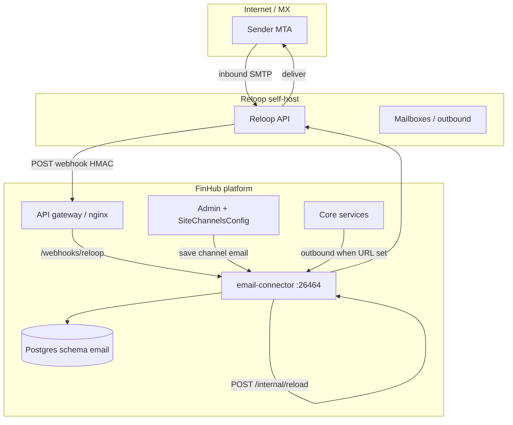

[English](./email-channel.md) | [简体中文](./email-channel.zh-CN.md) | [繁體中文](./email-channel.zh-TW.md)

# 郵件渠道（選用，Reloop）

FinHub 可透過平台託管傳輸投遞 **智能體郵件**：全站共用 **一個已驗證發信網域**，依 `(tenant, user, agent)` 三元組在 Reloop 上 **開通信箱**。**綁定模型 A**：每個租戶同時最多 **綁定一個寄件地址**。

**email-connector** 服務為 **選用**，**預設關閉**。停止該服務 **不會** 影響網頁對話。**delivery** 在設定 `EMAIL_CONNECTOR_URL` 與（選用）`CONFIG_EMAIL_CONNECTOR_URL` 後經 connector 外寄；**identity-service** 以 `EMAIL_CONNECTOR_URL` 執行 Admin test-connection/status。**orchestrator 不使用** `EMAIL_CONNECTOR_URL`。

**生產環境：** 在自有網路 **自建 Reloop**。**Reloop Cloud** 僅供 **示範/實驗**（Admin 中 `api_base_url` 留空）。本文不包含 v1 的 **自帶 Gmail/IMAP**、**agentmail.to** 或 **每租戶獨立網域**。

## 架構



| 元件 | 預設隨包啟用？ | 作用 |
|------|----------------|------|
| **email-connector** | 否（Compose `email` profile；Helm `services.email-connector.enabled: false`） | Webhook、綁定/開通 API、外寄 |
| **Reloop** | 維運自建 | MX、API、信箱生命週期 |
| **Admin 渠道 `email`** | Admin → 渠道 → 郵件 | 租戶 `reloop_*` 設定；GET/PUT 遮罩 |
| **終端使用者綁定 UI** | v1 未交付 | 使用使用者 Bearer 呼叫 HTTP API |

### 資料模型（schema `email`）

| 表 | 用途 |
|----|------|
| `email_agent_mailbox_bind` | 使用者/智能體信箱綁定 |
| `email_bind_state_used` | 一次性綁定狀態消耗 |
| `email_user_agent_preference` | 入站郵件首選智能體 |
| `email_processed_message` | 冪等 / 入站處理稽核 |

## 前置條件

| 要求 | 說明 |
|------|------|
| FinHub 核心堆疊健康 | [`install.zh-TW.md`](./install.zh-TW.md) → `doctor.sh` 通過 |
| Postgres `DATABASE_URL` 含 `?schema=email` | **email-connector** 必需（見環境表） |
| **Reloop 自建** | 生產 MTA + API；非 Reloop Cloud |
| 已驗證 **平台網域** | 依 Reloop 文件設定 DNS；自 Reloop 取得 `domain_id` |
| 公網 **HTTPS** 閘道 | Webhook `https://<gateway-host>/webhooks/reloop`，有效 TLS |
| `INTERNAL_SERVICE_TOKEN` | 機群共用密鑰（[`env-reference.zh-TW.md`](./env-reference.zh-TW.md)）；用於 `/internal/*` |

## Reloop 自建與 API 密鑰

1. 依廠商自建文件部署 Reloop（版本由 SecOps 固定）。
2. 為 FinHub 建立前綴 `rl_…` 的 API 密鑰（存保险箱；僅在 Admin 設定）。
3. 註冊與 Admin 中 `agent_mailbox_domain` **相同** 的已驗證網域。
4. 完成 Reloop **網域驗證**；記錄 **`domain_id`** 供 Admin 渠道設定。
5. 在 **Reloop 主控台** 中手動註冊入站 Webhook URL（FinHub 不會自動註冊）：

   `https://<gateway-host>/webhooks/reloop`

   使用 Reloop 提供的 **Webhook 簽章密鑰**；寫入 Admin 的 `webhook_secret`（勿提交至 git）。

僅實驗環境可省略 `api_base_url` 以使用 Reloop Cloud — **生產禁止使用**。

## DNS（MX、SPF、DKIM、驗證）

遵循 **Reloop 目前文件**。維運常見項目：

| 記錄類型 | 用途 |
|----------|------|
| **MX** | 指向 Reloop 為本安裝指定的入站主機 |
| **SPF** | 為已驗證網域包含 Reloop 出站來源 |
| **DKIM** | 發佈 Reloop 在網域設定後提供的 selector |
| **網域驗證** | TXT 或 CNAME，直至 Reloop 顯示已驗證 |

DNS 生效後，在 Reloop UI/API 確認網域 **已驗證**，記下 **`domain_id`**。

## 網路與入口

| 路徑 | 暴露範圍 | 鑑權 |
|------|----------|------|
| `POST /webhooks/reloop` | 經閘道 **公網** | HMAC（Reloop `webhook_secret`） |
| `GET /internal/health` | 內網 / mesh | 無或隨發佈包 |
| `/internal/status`、`/reload`、`/test-connection`、`/send-outbound`、`/provision`、`/bind` | 僅內網 | `INTERNAL_SERVICE_TOKEN` |
| `/api/email/*` | 經閘道 | 使用者 **Bearer** JWT |

隨包 **API 閘道（nginx）** 路由（**勿自行新增 nginx 設定**）：

- `POST /webhooks/reloop`
- `GET /api/email/bind/state`、`POST /api/email/bind`、`POST /api/email/provision`、`GET /api/email/status`

| 部署 | connector 關閉時的閘道行為 |
|------|---------------------------|
| **Docker Compose** | 路由保留；variable upstream + resolver 指向 **email-connector:26464** — 閘道可啟動；connector 未執行前路徑回傳 **502**。 |
| **Helm** | 僅當 `services.email-connector.enabled: true` 時渲染郵件 nginx 區塊；關閉時不暴露上述路由（無 502 占位）。 |

保留 Reloop HMAC 驗證所需的請求標頭與內文。

**TLS：** 在入口終止 HTTPS；Reloop Webhook 須能存取受信任的公網 URL。

## 映像

| 情境 | 映像引用 |
|------|----------|
| 生產 compose | `${CHATKIT_REGISTRY}/email-connector:${CHATKIT_VERSION}` |
| 離線包（`load-images.sh` 後） | `local/chatkit/email-connector:${VERSION}`（已列入離線映像清單） |
| GHCR（參考） | `ghcr.io/finogeeks/chatkit/email-connector:<version>` |

Compose：**服務名** `email-connector`，**容器名** `chatkit-email-connector`，**profile** `email`，定義於 **`docker-compose.prod.yml`**（無獨立 compose 覆寫檔）。

## 啟用 connector

### Docker Compose

預設 **關閉**。在生產 compose 上啟用 `email` profile：

```bash
export EMAIL_CONNECTOR_URL=http://chatkit-email-connector:26464
export CONFIG_EMAIL_CONNECTOR_URL=http://chatkit-email-connector:26464
docker compose -f docker-compose.prod.yml --profile email up -d email-connector
# then restart identity-service and delivery so they pick up the URL
```

將 `EMAIL_CONNECTOR_URL` / `CONFIG_EMAIL_CONNECTOR_URL` 寫入 `.env`（或發佈包文件中的同等機制）後，**重啟 identity-service 與 delivery**。

### Helm

Chart 單一開關（發佈包 `422800e7` 及以後）：啟用 connector 時會自動注入對等 env 與閘道路由。

```yaml
services:
  email-connector:
    enabled: true
```

```bash
helm upgrade --install <release> <chart-path> \
  -f deploy/helm/values-whitelabel.yaml \
  --set services.email-connector.enabled=true
```

當 `services.email-connector.enabled: true` 時，chart 為 **identity-service** 與 **delivery** 設定 **`EMAIL_CONNECTOR_URL`**=`http://email-connector:26464`，為 **delivery** 設定 **`CONFIG_EMAIL_CONNECTOR_URL`** 為同一 URL，並渲染郵件 nginx 區塊。為 **false** 時省略上述 env 且不渲染閘道郵件路由 — **勿**在 `servicesEnv` 中手動填寫這些 URL。

## 環境與密鑰

### email-connector 容器

| 變數 | 密鑰？ | 必填 | 說明 |
|------|--------|------|------|
| `DATABASE_URL` | 是 | 是 | Postgres DSN，含 `?schema=email` |
| `PORT` | 否 | 否（預設 **26464**） | 監聽埠 |
| `ORCHESTRATOR_URL` | 否 | 是 | orchestrator 基底 URL |
| `IDENTITY_SERVICE_URL` | 否 | 是 | identity-service 基底 URL |
| `INTERNAL_SERVICE_TOKEN` | 是 | 是 | 與其它服務相同；`/internal/*` |
| `EMAIL_CONNECTOR_TENANT_ID` | 否 | 否 | 選用單租戶過濾 |

**僅 dev/實驗後備**（生產用 Admin 渠道欄位 — 客戶 `.env` 勿設）：

`RELOOP_API_KEY`、`RELOOP_WEBHOOK_SECRET`、`RELOOP_DOMAIN_ID`、`RELOOP_API_BASE_URL`、`EMAIL_CONNECTOR_AGENT_MAILBOX_DOMAIN` 及文件中的 `EMAIL_CONNECTOR_*` 別名。

### 對等服務

| 服務 | 變數 | 密鑰？ | 用途 |
|------|------|--------|------|
| **identity-service** | `EMAIL_CONNECTOR_URL` | 否 | Admin test-connection / status |
| **delivery** | `EMAIL_CONNECTOR_URL` | 否 | 外寄至 connector |
| **delivery** | `CONFIG_EMAIL_CONNECTOR_URL` | 否 | 選用；發佈包接線時的同類鉤子 |

**Compose：** 在 `.env` 為 **identity-service** 與 **delivery** 設定 **`http://chatkit-email-connector:26464`**（delivery 可選 `CONFIG_EMAIL_CONNECTOR_URL`），並重啟二者。**Helm：** 當 `services.email-connector.enabled: true` 時 chart 自動注入 **`http://email-connector:26464`**（關閉時省略）。**orchestrator 不設定** `EMAIL_CONNECTOR_URL`。

### Admin → 渠道 → 郵件（生產 Reloop）

| 欄位 | 密鑰？ | 說明 |
|------|--------|------|
| `reloop_api_key` | 是 | GET/PUT 遮罩；前綴 `rl_…` |
| `webhook_secret` | 是 | `/webhooks/reloop` HMAC；Admin API 遮罩 |
| `domain_id` | 否 | Reloop 驗證後取得 |
| `agent_mailbox_domain` | 否 | 平台共用已驗證網域 |
| `api_base_url` | 否 | 自建 Reloop API 根；**留空** → Reloop Cloud（僅示範） |

租戶渠道欄位存於 **SiteChannelsConfig**（`channel` id `email`）。Admin 儲存會觸發 connector 上 `POST /internal/reload`。

## Admin 主控台（步驟 A–E）

| 步驟 | 操作 |
|------|------|
| **A. 啟用執行環境** | **Compose：** `email` profile + `.env` 對端 URL，重啟 identity-service 與 delivery。**Helm：** 僅 `--set services.email-connector.enabled=true`（chart 接線對等服務與 nginx）。 |
| **B. Reloop** | 自建 Reloop；建立 `rl_…` API 密鑰；在 Reloop 主控台 **手動** 註冊 Webhook URL 與簽章密鑰。 |
| **C. DNS** | 發佈 MX/SPF/DKIM/驗證記錄；等候 Reloop 網域驗證；複製 `domain_id`。 |
| **D. Admin → 渠道 → 郵件** | 填寫 `reloop_api_key`、`webhook_secret`、`domain_id`、`agent_mailbox_domain`、`api_base_url`（自建 API 根）。儲存（觸發 reload）。 |
| **E. 驗證** | 執行下文狀態與 test-connection；透過 API 完成開通/綁定冒煙。 |

Admin GET/PUT 中密鑰 **遮罩** — 僅在輪替時重新貼上完整值。

## 驗證

### 狀態欄位

使用服務權杖查詢內部狀態：

```bash
curl -sS -H "Authorization: Bearer <INTERNAL_SERVICE_TOKEN>" \
  http://chatkit-email-connector:26464/internal/status
```

常見欄位：

| 欄位 | 含義 |
|------|------|
| `transport_ready` | 依租戶/Admin 設定可存取 Reloop API |
| `domain_verified` | 設定網域通過 Reloop 驗證 |
| `webhook_configured` | Webhook 密鑰與公網 URL 一致 |
| `last_inbound_at` | 最近處理入站 Webhook（首封郵件前可為 null） |

### 測試連線

```bash
curl -sS -X POST -H "Authorization: Bearer <INTERNAL_SERVICE_TOKEN>" \
  http://chatkit-email-connector:26464/internal/test-connection
```

### 端對端（僅 API — 無綁定 UI）

替換占位符；使用登入流程得到的真實使用者 JWT。

**1. 開通信箱**

```bash
curl -sS -X POST \
  -H "Authorization: Bearer <USER_ACCESS_TOKEN>" \
  -H "Content-Type: application/json" \
  -d '{"agent_id":"<AGENT_UUID>"}' \
  https://<gateway-host>/api/email/provision
```

**2. 綁定寄件人（每租戶一個）**

```bash
curl -sS -X POST \
  -H "Authorization: Bearer <USER_ACCESS_TOKEN>" \
  -H "Content-Type: application/json" \
  -d '{"agent_id":"<AGENT_UUID>","bind_state":"<BIND_STATE_FROM_PROVISION>"}' \
  https://<gateway-host>/api/email/bind
```

**3. 查詢綁定狀態**

```bash
curl -sS -H "Authorization: Bearer <USER_ACCESS_TOKEN>" \
  "https://<gateway-host>/api/email/bind/state?agent_id=<AGENT_UUID>"
```

**4. 使用者狀態**

```bash
curl -sS -H "Authorization: Bearer <USER_ACCESS_TOKEN>" \
  https://<gateway-host>/api/email/status
```

**5. 入站郵件** — 從外部信箱寄至已開通地址；確認 `last_inbound_at` 更新且智能體依產品路由收到對話。

**6. 出站回覆** — 在郵件對話上觸發智能體回覆（依產品而異）；確認 **delivery** 在已設定 `EMAIL_CONNECTOR_URL` / `CONFIG_EMAIL_CONNECTOR_URL` 時可到達 connector（identity 用於 Admin 路徑）。

## 監控與日誌

| 訊號 | 來源 |
|------|------|
| 存活 | 埠 **26464** 上 `GET /internal/health` |
| Webhook 失敗 | 閘道 + connector 日誌（HMAC 錯誤 4xx） |
| Reloop 錯誤 | `/internal/test-connection`、send-outbound 相關日誌 |
| 資料庫 | schema `email` 遷移；連線錯誤 |

選用 Prometheus：僅當發佈包在 connector 暴露 `/metrics` 時抓取（v1 不預設假設）。建議對重複 Webhook 401/403 與外寄 5xx 做日誌告警。

## 停用與回復

1. 刪除或註解 `EMAIL_CONNECTOR_URL` / `CONFIG_EMAIL_CONNECTOR_URL` 以停止外寄轉發。
2. 關閉 compose profile 或 Helm 設 `services.email-connector.enabled=false`。
3. 在 Admin 停用渠道或依變更窗口清理租戶密鑰。
4. Reloop：下線 Webhook 或輪替密鑰以退役渠道。

核心對話全程可用。

## 故障排解

| 現象 | 檢查項 |
|------|--------|
| `domain_verified: false` | DNS 傳播；`domain_id` 與 Reloop 一致；`agent_mailbox_domain` 拼寫 |
| Webhook 401/403 | Admin `webhook_secret` 與 Reloop 一致；閘道保留 HMAC 所需內文 |
| 無入站 | MX 指向 Reloop；Webhook URL 為公網 HTTPS；防火牆允許 Reloop → 閘道 |
| 閘道對 `/webhooks/reloop` 或 `/api/email/*` 回傳 502（**Compose**） | connector 未執行 — connector 拉起前屬預期（Helm 關閉時不渲染路由） |
| 從不外寄 | **delivery** / **identity-service** 未設 `EMAIL_CONNECTOR_URL`；變更 env 後未重啟；`transport_ready` 為 true |
| 綁定失敗 | 每租戶僅一綁；使用新 `bind_state`；使用者權杖有效 |
| 生產誤用 Cloud | Admin 填寫自建 `api_base_url`；策略禁止留空 |

## 已知限制（v1）

- 僅 **綁定模型 A** — 平台共用網域；**v1 不支援每租戶自訂網域**。
- 每租戶 **一個** 活躍寄件綁定。
- **無** 終端使用者綁定/開通 UI — **僅 HTTP API**（及 Admin 渠道設定）。
- **Reloop 入站 Webhook** 須在 **Reloop 主控台手動註冊**（FinHub 不會自動註冊）。
- **Reloop Cloud**（`api_base_url` 留空）— **僅示範/實驗**；不可用於生產。
- **無** 自帶 Gmail/IMAP 或 agentmail.to。
- 外寄郵件經 **delivery**（`EMAIL_CONNECTOR_URL` / 選用 `CONFIG_EMAIL_CONNECTOR_URL`）接線，**非 orchestrator**。

## 安全說明

| 主題 | 建議 |
|------|------|
| **密鑰輪替** | 在 Reloop 與 Admin 同步輪替 `reloop_api_key`、`webhook_secret` 後儲存以 reload；依機群流程輪替 `INTERNAL_SERVICE_TOKEN` 並重啟 connector。 |
| **HMAC Webhook** | 將 `webhook_secret` 視為憑證；connector 拒絕未簽章或簽章錯誤請求。 |
| **Admin API** | 遮罩密鑰仍可操作渠道 — 限制 Admin 存取。 |
| **TLS** | 勿將 :26464 直接暴露公網；僅經閘道路由。 |

## 相關文件

- [安裝](./install.zh-TW.md) · [環境參考](./env-reference.zh-TW.md) · [冒煙清單](../smoke-checklist.zh-TW.md)
- [代理部署手冊](../agent-deploy-runbook.zh-TW.md) · [`skills/finhub-deploy/SKILL.md`](../../skills/finhub-deploy/SKILL.md)
