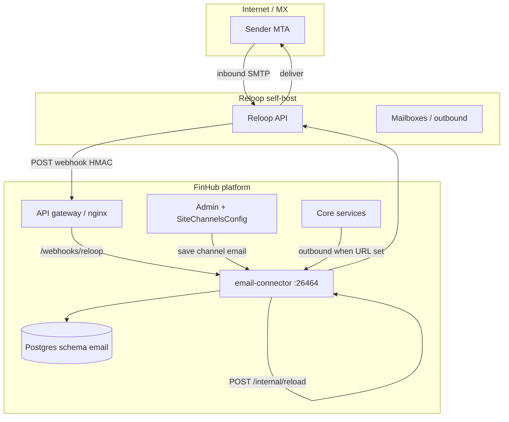

[English](./email-channel.md) | [简体中文](./email-channel.zh-CN.md) | [繁體中文](./email-channel.zh-TW.md)

# 郵件渠道（選用，Reloop）

FinHub 可透過平台託管傳輸投遞 **智能體郵件**：全站共用 **一個已驗證發信網域**，依 `(tenant, user, agent)` 三元組在 Reloop 上 **開通信箱**。**綁定模型 A**：每個租戶同時最多 **綁定一個寄件地址**。

**email-connector** 服務為 **選用**，**預設關閉**。停止該服務 **不會** 影響網頁對話。僅當設定 `EMAIL_CONNECTOR_URL` / `CONFIG_EMAIL_CONNECTOR_URL` 時，其它平台路徑才會將外寄郵件轉發至 connector。

**生產環境：** 在自有網路 **自建 Reloop**。**Reloop Cloud** 僅供 **示範/實驗**（Admin 中 `api_base_url` 留空）。本文不包含 v1 的 **自帶 Gmail/IMAP**、**agentmail.to** 或 **每租戶獨立網域**。

Compose 服務名、映像 tag、Helm 鍵以 **離線發佈包** 為準；發佈包含郵件打包後，請對照並消除文中的 `<!-- TODO(packaging): ... -->` 標記。

## 架構



| 元件 | 預設隨包啟用？ | 作用 |
|------|----------------|------|
| **email-connector** | 否（`email` profile / `emailConnector.enabled: false`） | Webhook、綁定/開通 API、外寄 |
| **Reloop** | 維運自建 | MX、API、信箱生命週期 |
| **Admin 渠道 `email`** | Admin → 渠道 → 郵件 | 租戶 `reloop_*` 設定；GET/PUT 遮罩 |
| **終端使用者綁定 UI** | v1 未交付 | 使用使用者 Bearer 呼叫 HTTP API |

### 資料模型（schema `email`）

| 表 | 用途 |
|----|------|
| `email_agent_mailbox_bind` | 使用者/智能體信箱綁定 |
| `email_bind_state_used` | 一次性綁定狀態消耗 |
| `email_user_agent_preference` | 入站郵件首選智能體 |
| `email_processed_message` | 冪等 / 入站處理稽核 |

## 前置條件

| 要求 | 說明 |
|------|------|
| FinHub 核心堆疊健康 | [`install.zh-TW.md`](./install.zh-TW.md) → `doctor.sh` 通過 |
| Postgres 可被 connector 存取 | 發佈包設定 convstore / 平台 DSN |
| **Reloop 自建** | 生產 MTA + API；非 Reloop Cloud |
| 已驗證 **平台網域** | 依 Reloop 文件設定 DNS；自 Reloop 取得 `domain_id` |
| 公網 **HTTPS** 閘道 | Webhook `https://<gateway-host>/webhooks/reloop`，有效 TLS |
| `INTERNAL_SERVICE_TOKEN` | 機群共用密鑰（[`env-reference.zh-TW.md`](./env-reference.zh-TW.md)）；用於 `/internal/*` |

## Reloop 自建與 API 密鑰

1. 依廠商自建文件部署 Reloop（版本由 SecOps 固定）。
2. 為 FinHub 建立前綴 `rl_…` 的 API 密鑰（存保险箱；僅在 Admin 設定）。
3. 註冊與 Admin 中 `agent_mailbox_domain` **相同** 的已驗證網域。
4. 完成 Reloop **網域驗證**；記錄 **`domain_id`** 供 Admin 渠道設定。
5. 設定 Reloop 將入站事件 POST 至：

   `https://<gateway-host>/webhooks/reloop`

   使用 Reloop 提供的 **Webhook 簽章密鑰**；寫入 Admin 的 `webhook_secret`（勿提交至 git）。

僅實驗環境可省略 `api_base_url` 以使用 Reloop Cloud — **生產禁止使用**。

## DNS（MX、SPF、DKIM、驗證）

遵循 **Reloop 目前文件**。維運常見項目：

| 記錄類型 | 用途 |
|----------|------|
| **MX** | 指向 Reloop 為本安裝指定的入站主機 |
| **SPF** | 為已驗證網域包含 Reloop 出站來源 |
| **DKIM** | 發佈 Reloop 在網域設定後提供的 selector |
| **網域驗證** | TXT 或 CNAME，直至 Reloop 顯示已驗證 |

DNS 生效後，在 Reloop UI/API 確認網域 **已驗證**，記下 **`domain_id`**。

## 網路與入口

| 路徑 | 暴露範圍 | 鑑權 |
|------|----------|------|
| `POST /webhooks/reloop` | 經閘道 **公網** | HMAC（Reloop `webhook_secret`） |
| `GET /internal/health` | 內網 / mesh | 無或隨發佈包 |
| `/internal/status`、`/reload`、`/test-connection`、`/send-outbound`、`/provision`、`/bind` | 僅內網 | `INTERNAL_SERVICE_TOKEN` |
| `/api/email/*` | 經閘道 | 使用者 **Bearer** JWT |

閘道須將 `/webhooks/reloop` 轉至 **email-connector** **26464**，且勿剥离 HMAC 所需標頭/內文。

<!-- TODO(packaging): confirm nginx location block and upstream service name in release `docker-compose.prod.yml` / Helm ingress templates. -->

**TLS：** 在入口終止 HTTPS；Reloop Webhook 須能存取受信任的公網 URL。

## 啟用 connector

### Docker Compose

預設 **關閉**。發佈包提供 `email` profile 時：

<!-- TODO(packaging): confirm email-connector image repository/tag in CHATKIT_REGISTRY and `load-images.sh` manifest. -->

<!-- TODO(packaging): confirm exact compose invocation from release README, e.g. `docker compose -f docker-compose.prod.yml --profile email up -d email-connector`. -->

<!-- TODO(packaging): insert documented `-f` overlay file name if the release ships one beside docker-compose.prod.yml. -->

```bash
# 範例 — 生產前以發佈包 README 為準
docker compose -f docker-compose.prod.yml \
  --profile email \
  up -d email-connector
```

<!-- TODO(packaging): confirm compose service name (placeholder above: `email-connector`) and profile name (`email`). -->

設定平台環境變數使核心服務可存取 connector（見下表）。啟用外寄後重啟相關服務。

### Helm

<!-- TODO(packaging): confirm chart value path, e.g. `emailConnector.enabled: true` and secret/env key names in values schema. -->

```bash
helm upgrade --install <release> <chart-path> \
  -f deploy/helm/values-whitelabel.yaml \
  --set emailConnector.enabled=true
```

確認 Ingress 將 `/webhooks/reloop` 暴露至 connector Service 埠 **26464**。

## 環境與密鑰

| 變數 | 密鑰？ | 誰設定 | 說明 |
|------|--------|--------|------|
| `INTERNAL_SERVICE_TOKEN` | 是 | `gen-secrets.sh` / 維運 | `/internal/*` 必需；依發佈包流程輪替 |
| `EMAIL_CONNECTOR_URL` | 否 | 維運 | 核心 → connector 外寄基底 URL（如 `http://email-connector:26464`） |
| `CONFIG_EMAIL_CONNECTOR_URL` | 否 | 維運 | 發佈包文件中的設定服務備用 URL |
| `DATABASE_URL` / convstore DSN | 是 | 發佈包 / 維運 | connector 需要 schema `email`；鍵名見 `.env.example` |
| `reloop_api_key` | 是 | **Admin** → 渠道 → 郵件 | GET/PUT 遮罩；前綴 `rl_…` |
| `webhook_secret` | 是 | **Admin** | `/webhooks/reloop` HMAC；Admin API 遮罩 |
| `domain_id` | 否 | **Admin** | Reloop 驗證後取得 |
| `agent_mailbox_domain` | 否 | **Admin** | 平台共用已驗證網域 |
| `api_base_url` | 否 | **Admin**（選用） | 自建 Reloop API 根 URL；**留空** → Reloop Cloud（僅示範） |

租戶渠道欄位存於 **SiteChannelsConfig**（`channel` id `email`）。Admin 儲存會觸發 connector 上 `POST /internal/reload`。

## Admin 主控台（步驟 A–E）

| 步驟 | 操作 |
|------|------|
| **A. 啟用執行環境** | 拉起 `email-connector`（compose profile 或 Helm）；若需外寄郵件則設定 `EMAIL_CONNECTOR_URL` / `CONFIG_EMAIL_CONNECTOR_URL`。 |
| **B. Reloop** | 自建 Reloop；建立 `rl_…` API 密鑰；設定 Webhook URL 與簽章密鑰。 |
| **C. DNS** | 發佈 MX/SPF/DKIM/驗證記錄；等候 Reloop 網域驗證；複製 `domain_id`。 |
| **D. Admin → 渠道 → 郵件** | 填寫 `reloop_api_key`、`webhook_secret`、`domain_id`、`agent_mailbox_domain`、`api_base_url`（自建 API 根）。儲存（觸發 reload）。 |
| **E. 驗證** | 執行下文狀態與 test-connection；透過 API 完成開通/綁定冒煙。 |

Admin GET/PUT 中密鑰 **遮罩** — 僅在輪替時重新貼上完整值。

## 驗證

### 狀態欄位

使用服務權杖查詢內部狀態：

```bash
curl -sS -H "Authorization: Bearer <INTERNAL_SERVICE_TOKEN>" \
  http://email-connector:26464/internal/status
```

常見欄位：

| 欄位 | 含義 |
|------|------|
| `transport_ready` | 依租戶/Admin 設定可存取 Reloop API |
| `domain_verified` | 設定網域通過 Reloop 驗證 |
| `webhook_configured` | Webhook 密鑰與公網 URL 一致 |
| `last_inbound_at` | 最近處理入站 Webhook（首封郵件前可為 null） |

### 測試連線

```bash
curl -sS -X POST -H "Authorization: Bearer <INTERNAL_SERVICE_TOKEN>" \
  http://email-connector:26464/internal/test-connection
```

### 端對端（僅 API — 無綁定 UI）

替換占位符；使用登入流程得到的真實使用者 JWT。

**1. 開通信箱**

```bash
curl -sS -X POST \
  -H "Authorization: Bearer <USER_ACCESS_TOKEN>" \
  -H "Content-Type: application/json" \
  -d '{"agent_id":"<AGENT_UUID>"}' \
  https://<gateway-host>/api/email/provision
```

**2. 綁定寄件人（每租戶一個）**

```bash
curl -sS -X POST \
  -H "Authorization: Bearer <USER_ACCESS_TOKEN>" \
  -H "Content-Type: application/json" \
  -d '{"agent_id":"<AGENT_UUID>","bind_state":"<BIND_STATE_FROM_PROVISION>"}' \
  https://<gateway-host>/api/email/bind
```

**3. 查詢綁定狀態**

```bash
curl -sS -H "Authorization: Bearer <USER_ACCESS_TOKEN>" \
  "https://<gateway-host>/api/email/bind/state?agent_id=<AGENT_UUID>"
```

**4. 使用者狀態**

```bash
curl -sS -H "Authorization: Bearer <USER_ACCESS_TOKEN>" \
  https://<gateway-host>/api/email/status
```

**5. 入站郵件** — 從外部信箱寄至已開通地址；確認 `last_inbound_at` 更新且智能體依產品路由收到對話。

**6. 出站回覆** — 在郵件對話上觸發智能體回覆（依產品而異）；僅在設定 `EMAIL_CONNECTOR_URL` 時確認投遞成功。

## 監控與日誌

| 訊號 | 來源 |
|------|------|
| 存活 | 埠 **26464** 上 `GET /internal/health` |
| Webhook 失敗 | 閘道 + connector 日誌（HMAC 錯誤 4xx） |
| Reloop 錯誤 | `/internal/test-connection`、send-outbound 相關日誌 |
| 資料庫 | schema `email` 遷移；連線錯誤 |

選用 Prometheus：僅當發佈包在 connector 暴露 `/metrics` 時抓取（v1 不預設假設）。建議對重複 Webhook 401/403 與外寄 5xx 做日誌告警。

## 停用與回復

1. 刪除或註解 `EMAIL_CONNECTOR_URL` / `CONFIG_EMAIL_CONNECTOR_URL` 以停止外寄轉發。
2. 關閉 compose profile 或 Helm 設 `emailConnector.enabled=false`。
3. 在 Admin 停用渠道或依變更窗口清理租戶密鑰。
4. Reloop：下線 Webhook 或輪替密鑰以退役渠道。

核心對話全程可用。

## 故障排解

| 現象 | 檢查項 |
|------|--------|
| `domain_verified: false` | DNS 傳播；`domain_id` 與 Reloop 一致；`agent_mailbox_domain` 拼寫 |
| Webhook 401/403 | Admin `webhook_secret` 與 Reloop 一致；閘道保留 HMAC 所需內文 |
| 無入站 | MX 指向 Reloop；Webhook URL 為公網 HTTPS；防火牆允許 Reloop → 閘道 |
| 從不外寄 | 核心未設 `EMAIL_CONNECTOR_URL`；connector 執行中；`transport_ready` 為 true |
| 綁定失敗 | 每租戶僅一綁；使用新 `bind_state`；使用者權杖有效 |
| 生產誤用 Cloud | Admin 填寫自建 `api_base_url`；策略禁止留空 |

## 已知限制（v1）

- 僅 **綁定模型 A** — 平台共用網域；無每租戶自訂網域。
- 每租戶 **一個** 活躍寄件綁定。
- **無** 終端使用者綁定 UI — 僅 API + Admin。
- **無** 自帶 Gmail/IMAP 或 agentmail.to。
- 非郵件功能外寄須明確設定 connector URL。

## 安全說明

| 主題 | 建議 |
|------|------|
| **密鑰輪替** | 在 Reloop 與 Admin 同步輪替 `reloop_api_key`、`webhook_secret` 後儲存以 reload；依機群流程輪替 `INTERNAL_SERVICE_TOKEN` 並重啟 connector。 |
| **HMAC Webhook** | 將 `webhook_secret` 視為憑證；connector 拒絕未簽章或簽章錯誤請求。 |
| **Admin API** | 遮罩密鑰仍可操作渠道 — 限制 Admin 存取。 |
| **TLS** | 勿將 :26464 直接暴露公網；僅經閘道路由。 |

## 相關文件

- [安裝](./install.zh-TW.md) · [環境參考](./env-reference.zh-TW.md) · [冒煙清單](../smoke-checklist.zh-TW.md)
- [代理部署手冊](../agent-deploy-runbook.zh-TW.md) · [`skills/finhub-deploy/SKILL.md`](../../skills/finhub-deploy/SKILL.md)
