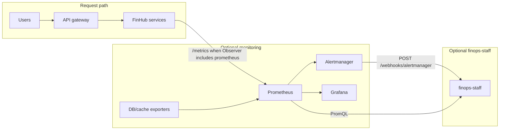

[English](./monitoring.md) | [简体中文](./monitoring.zh-CN.md) | [繁體中文](./monitoring.zh-TW.md)

# Monitoring and FinOps alerting

FinHub runs without a monitoring stack. Chat, gateways, and databases operate on the **request path**; Prometheus, Alertmanager, and Grafana are **optional** and off that path unless you enable them.

When you opt in to **finops-staff** (see [FinOps staff](./finops-staff.md)), the agent **reads** Prometheus (PromQL) and **receives** Alertmanager webhooks. It does not replace your monitoring toolchain.

This guide is verified against FinHub release layout at vendor commit `cb3e6418` (compose profiles, Helm templates, alert rules). Exact file paths live in your **offline release**; this public repo ships [example snippets](../../deploy/monitoring/) only.

## Architecture



| Component | Ships in default FinHub deploy? | Role |
|-----------|----------------------------------|------|
| finclaw `/metrics` | Yes (Observer backend; no extra profile) | Application metrics |
| Prometheus | No (optional `observability` compose profile or your cluster) | Scrape + rule evaluation |
| Alertmanager | No (same) | Route alerts |
| Grafana | No (same) | Dashboards |
| finops-staff | No (`finops-staff` profile / Helm `finopsStaff.enabled`) | Diagnose + gated remediation |

## Metrics endpoints and scrape auth

Enable exposition with `AI_INFRA_RS_OBSERVER_BACKEND` including `prometheus` (release default is often `log,prometheus`). Helm sets the same via `servicesEnv.ai-infra-rs` and tenant fleet env unless `observability.prometheus.enabled=false`.

| Target | Path | Port (typical) | Scrape auth (shipped configs) | Notes |
|--------|------|----------------|--------------------------------|-------|
| Platform **ai-infra-rs** (finclaw) | `/metrics` | `26450` | **None** | Compose publishes `26450`; dogfood Prometheus uses Docker DNS `chatkit-ai-infra-rs:26450` |
| Tenant claws (finclaw / Hermes / openclaw) | `/metrics` when Observer includes `prometheus`; else `/health` only | `26450` (finclaw) | **None** when `/metrics` is exposed | Hermes/openclaw may be health-only — see alert `FinHubFinOpsAdapterProbeFailed` |
| **api-gateway** (nginx) | — | ingress HTTP(S) | — | **No** `/metrics` on gateway in shipped compose; gateway error-budget rules need **ingress-nginx controller** metrics in Kubernetes |
| **postgres-exporter** (observability profile) | `/metrics` | `9187` | **None** | Dogfood only; not part of default stack |
| **redis-exporter** (observability profile) | `/metrics` | `9121` | **None** | Dogfood only |
| **finops-staff** | `/health`, `/ping` | `26116` | N/A (not scraped) | Alert **ingress** uses bearer token — see [Alertmanager → finops-staff](#alertmanager--finops-staff) |
| **prometheus-dogfood** | UI `/-/ready` | `9090` | **None** (localhost bind) | Profile `observability` |
| **alertmanager-dogfood** | — | `9093` (internal) | **None** | No host port in dogfood compose |
| **grafana-dogfood** | UI | `3030` → container `3000` | **Admin password** (`GRAFANA_DOGFOOD_ADMIN_PASSWORD`) | Binds `127.0.0.1` only in dogfood compose |

**Customer mitigation for unauthenticated `/metrics`:** keep claws on internal networks; do not publish `26450` on public interfaces; use NetworkPolicy / security groups; or terminate scrape auth at a reverse proxy or Prometheus `authorization` credentials.

Kubernetes discovery (when using the release Helm chart):

- Pod annotations when `observability.prometheus.scrapeAnnotations=true`: `prometheus.io/scrape=true`, `prometheus.io/path=/metrics`, `prometheus.io/port=<claw-port>`.
- Optional `ServiceMonitor` CRs when `observability.prometheus.serviceMonitor.enabled=true` (requires Prometheus Operator CRDs).

Labels used for relabeling: `chatkit.finogeeks.com/runtime-adapter`, `chatkit.finogeeks.com/tenant-id` → target labels `runtime_adapter`, `tenant_id`.

## FinOps alert rules (Phase 1)

Rule source: `deploy/observability/finops-alert-rules.yaml` in the release (copy in [deploy/monitoring/finops-alert-rules.yaml](../../deploy/monitoring/finops-alert-rules.yaml)). Several expressions need **cluster-level** series (kubelet, kube-state-metrics, ingress-nginx, postgres_exporter on convstore). Compose dogfood reliably evaluates the **`chatkit.finops.compose`** group (finclaw `up`) plus exporter targets you enable.

| Alert name | Severity | Route (`chatkit_route`) | Meaning |
|------------|----------|-------------------------|---------|
| `FinHubFinOpsDiskLogVolumeHigh` | critical | page | PVC or container filesystem ~85%+ utilization |
| `FinHubFinOpsConvstorePostgresSaturated` | critical | page | convstore connections &gt; ~85% of `max_connections` (needs postgres_exporter) |
| `FinHubFinOpsGatewayErrorBudgetBurn` | warning | ticket | API gateway 5xx ratio &gt; 5% (ingress-nginx metrics) |
| `FinHubFinOpsGatewayErrorBudgetBurnCritical` | critical | page | API gateway 5xx ratio &gt; 15% |
| `FinHubFinOpsClawReadyBelowDesired` | warning | ticket | StatefulSet ready/desired &lt; 80% (kube-state-metrics proxy) |
| `FinHubFinOpsAdapterProbeFailed` | critical | page | finclaw scrape/health probe down |
| `FinHubFinOpsCapabilityRegression` | warning | ticket | finclaw loop recovery rate low with enough signals |
| `FinHubFinOpsComposeFinclawScrapeDown` | critical | page | Compose: `up{job="chatkit-ai-infra-rs",stack="compose"}==0` |

Routing labels: `chatkit_finops_alert` identifies the signal family for finops-staff and notification templates.

## Choose a path

| | **Option A — Reuse existing monitoring** | **Option B — Deploy alongside FinHub** |
|---|------------------------------------------|----------------------------------------|
| When | You already run Prometheus Operator, kube-prometheus-stack, or self-managed Prom/AM/Grafana | Lab or small on-prem without a metrics stack |
| FinHub changes | Scrape config, rule file, Alertmanager receiver, optional Grafana import | Enable compose `--profile observability` (+ optional finops overlays) |
| Production fit | Preferred for production | Dogfood-oriented; harden before production (see below) |

Agent workflow: [`skills/finhub-monitoring/SKILL.md`](../../skills/finhub-monitoring/SKILL.md).

---

## Option A — Reuse Prometheus / Alertmanager / Grafana

### Docker Compose / VM Prometheus

1. Copy or merge [prometheus-scrape-snippet.yml](../../deploy/monitoring/prometheus-scrape-snippet.yml) into your server’s config. Point `rule_files` at [finops-alert-rules.yaml](../../deploy/monitoring/finops-alert-rules.yaml).
2. Add scrape jobs for every target you run (platform claw at `:26450`, optional postgres/redis exporters).
3. Reload or restart Prometheus; confirm **Targets** are **UP** and **Rules** load (`/-/ready`, `/rules` API).

### Alertmanager → finops-staff

finops-staff accepts `POST /webhooks/alertmanager` when `FINOPS_STAFF_ALERT_WEBHOOK_TOKEN` is set (fail-closed if unset).

| Auth form | Header |
|-----------|--------|
| Bearer (Alertmanager native) | `Authorization: Bearer <FINOPS_STAFF_ALERT_WEBHOOK_TOKEN>` |
| Dedicated header | `x-finops-alert-webhook-token: <token>` |

Dogfood Alertmanager uses `bearer_token_file` pointing at the same value as `FINOPS_STAFF_ALERT_WEBHOOK_TOKEN` (compose: `deploy/compose/dogfood-secrets/alertmanager-bearer.token`).

Merge [alertmanager-finops-staff-receiver-snippet.yml](../../deploy/monitoring/alertmanager-finops-staff-receiver-snippet.yml) into your Alertmanager config. Webhook URL pattern: `http://<finops-staff-host>:26116/webhooks/alertmanager`.

Set `FINOPS_STAFF_PROMETHEUS_URL` to your Prometheus base URL (not the dogfood default).

### Grafana

- Datasource: Prometheus server URL (proxy mode).
- Import [grafana-finops-compose-dogfood.json](../../deploy/monitoring/grafana-finops-compose-dogfood.json) as a starting dashboard; adjust panels for your scrape labels.

### Kubernetes (release Helm chart + your prometheus stack)

The **FinHub Helm chart does not deploy** Prometheus, Alertmanager, or Grafana. It can emit:

| Resource | Helm values | Prerequisite |
|----------|-------------|--------------|
| `PrometheusRule` | `observability.alerts.enabled=true`, `observability.alerts.prometheusRule.enabled=true` (+ optional `labels.release` for your operator) | Prometheus Operator |
| `ServiceMonitor` | `observability.prometheus.serviceMonitor.enabled=true` | Prometheus Operator, shared or fleet tenant claws enabled |
| Pod `prometheus.io/*` annotations | `observability.prometheus.scrapeAnnotations=true` (default when observability prometheus enabled) | Any Prometheus with kubernetes_sd or Grafana Alloy |

It does **not** ship `PodMonitor`, `AlertmanagerConfig`, or Grafana charts.

**kube-prometheus-stack example (rules only):**

```yaml
observability:
  alerts:
    enabled: true
    prometheusRule:
      enabled: true
      labels:
        release: kube-prometheus-stack
```

**Alertmanager receivers** are owned by your cluster chart. The release documents placeholders in `values.yaml` → `observability.alertmanager` and a full example file `values-alertmanager-finops.example.yaml` in the release (and [public overlay](../../deploy/helm/values-alertmanager-finops.example.yaml); Slack/PagerDuty placeholders — not rendered by the FinHub chart). Wire `finhub-finops-staff` (or your receiver name) with `http_config.bearer_token_file` — mount the same Secret key as `finopsStaff.secretKeys.alertWebhookToken` (default `alert_webhook_token`). See [deploy/monitoring/alertmanager-finops-staff-receiver-snippet.yml](../../deploy/monitoring/alertmanager-finops-staff-receiver-snippet.yml).

**finops-staff on Kubernetes** (`finopsStaff.enabled=true`): Deployment + Service; values include `finopsStaff.prometheusUrl` (default `http://prometheus-operated:9090`), `fleetManagerUrl`, `policyMode: readonly`, `autoActDisabled: true`, `closedLoopEnabled: false`, and `notifyMinSeverity: warning` (`info` \| `warning` \| `critical`). Webhook and internal API tokens are wired via **`finopsStaff.existingSecret`** (production) or **`finopsStaff.createSecret.enabled`** (dev/lab chart-rendered Secret only). See [FinOps staff — Helm auth](./finops-staff.md#helm-auth-secrets) and [deploy/helm/README.md](../../deploy/helm/README.md).

If your cluster lacks Prometheus Operator CRDs, use plain scrape config against claw Service DNS names and load the rule YAML with your Prometheus server's `rule_files` mechanism — do not enable `serviceMonitor` or `prometheusRule` in the FinHub chart.

---

## Option B — Deploy the observability compose profile

Requires the release files `docker-compose.observability.yml`, `deploy/compose/prometheus-dogfood.yml`, `deploy/compose/alertmanager-dogfood.yml`, `deploy/observability/**`, and optional `docker-compose.finops-dogfood.yml`.

### Steps

1. From the release root, set **names only** in `.env` (never commit values):
   - `GRAFANA_DOGFOOD_ADMIN_PASSWORD` (required for Grafana in this profile)
   - `GRAFANA_DOGFOOD_ADMIN_USER` (optional; default `admin`)
   - For Alertmanager → finops-staff: `FINOPS_STAFF_ALERT_WEBHOOK_TOKEN`, `FINOPS_STAFF_INTERNAL_API_TOKEN`, and dogfood secret file `alertmanager-bearer.token` (same value as alert webhook token)
2. Start stack (adjust base compose file name per your bundle):

```bash
docker compose -f docker-compose.prod.yml \
  -f docker-compose.observability.yml \
  --profile observability up -d
```

3. Optional finops-staff + dogfood wiring:

```bash
docker compose -f docker-compose.prod.yml \
  -f docker-compose.observability.yml \
  -f docker-compose.finops-staff.yml \
  -f docker-compose.finops-dogfood.yml \
  --profile observability --profile finops-staff up -d
```

4. **Ports (dogfood defaults):** Prometheus `127.0.0.1:9090`, Grafana `127.0.0.1:3030`, finops-staff `127.0.0.1:26116` when `finops-dogfood` overlay is used.

### Verification

| Check | Command / action |
|-------|------------------|
| Prometheus targets | `curl -sf http://127.0.0.1:9090/api/v1/targets?state=active` — `chatkit-ai-infra-rs` job **up** |
| Rules loaded | `curl -sf http://127.0.0.1:9090/api/v1/rules` — groups `chatkit.finops.*` present |
| finclaw metrics | `curl -sf http://127.0.0.1:26450/metrics \| head` (from host if port published) |
| Alertmanager → staff | Configure test receiver; or POST a synthetic alert with valid bearer (see [FinOps staff](./finops-staff.md)) |
| Grafana | Open `http://127.0.0.1:3030`, login with admin env user/password, confirm Prometheus datasource |

### Air-gapped image load

Observability profile images (pinned in release `docker-compose.observability.yml`):

| Image | Tag |
|-------|-----|
| `prom/prometheus` | `v2.55.0` |
| `prom/alertmanager` | `v0.27.0` |
| `prometheuscommunity/postgres-exporter` | `v0.15.0` |
| `oliver006/redis_exporter` | `v1.62.0` |
| `grafana/grafana` | `11.2.2` |

Load from your offline tarball; Grafana/Alertmanager/Prometheus make **no outbound calls** in the default dogfood configs. finops-staff outbound (Slack, SMTP, etc.) stays off when URLs are empty.

---

## Production hardening (honest gaps)

The release labels this stack **dogfood**. Before production:

| Gap | Risk | Customer mitigation |
|-----|------|---------------------|
| **Dogfood branding** | Not a supported production observability product | Run Option A on your enterprise monitoring |
| **postgres-exporter `DATA_SOURCE_NAME`** | Inline DB credentials in compose env | Use secrets store, external exporter, or rotate credentials; never commit DSN |
| **No Prometheus TSDB volume** | Metrics lost on container recreate | Add persistent volume and retention flags |
| **No TLS/auth on Prometheus / Alertmanager UI** | Localhost bind mitigates only on single host | Terminate TLS at reverse proxy; enable auth or keep on management network |
| **Single replica** | No HA for Prom/AM/Grafana | Run clustered Prometheus/Alertmanager per your SRE standards |
| **Grafana default admin** | Weak if exposed | Strong password, SSO, or don't expose Grafana publicly |
| **Unauthenticated `/metrics`** | Leak operational detail | NetworkPolicy, internal-only Services, scrape via mesh |
| **Many alert rules idle on compose** | False sense of coverage | Add kube/ingress/postgres scrape jobs or accept compose-only firing rules |
| **Alertmanager ↔ staff token drift** | Webhook 401 | Mount bearer file from the same Secret as `finopsStaff.existingSecret`; match `secretKeys.alertWebhookToken` |

---

## Related docs

- [Install](./install.md) · [Environment reference](./env-reference.md) · [Day-2 ops](./day-2-ops.md)
- [FinOps staff](./finops-staff.md) — policy modes, tokens, webhook test
- [FinOps notifications](./finops-notifications.md) — outbound channels
- [`skills/finhub-monitoring/SKILL.md`](../../skills/finhub-monitoring/SKILL.md) — agent runbook
- [`skills/finhub-deploy/SKILL.md`](../../skills/finhub-deploy/SKILL.md) — core deploy (monitoring optional)
- [`deploy/monitoring/`](../../deploy/monitoring/) — public config snippets
